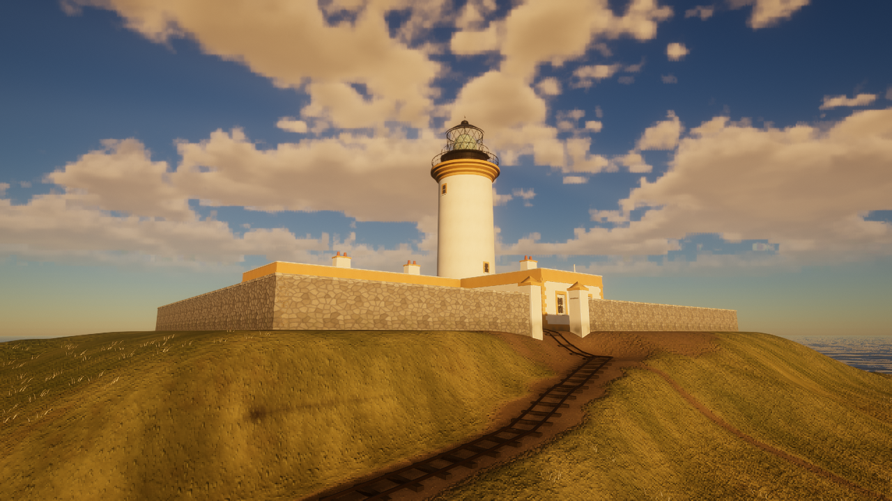
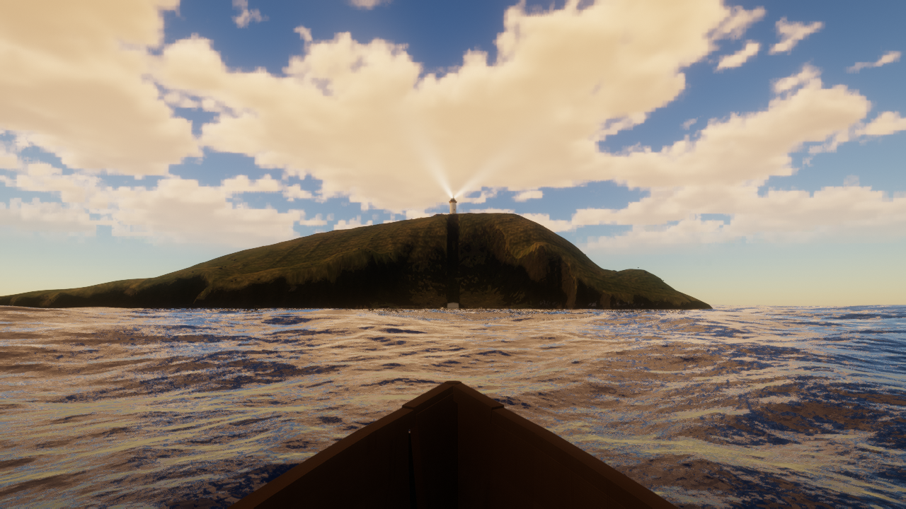
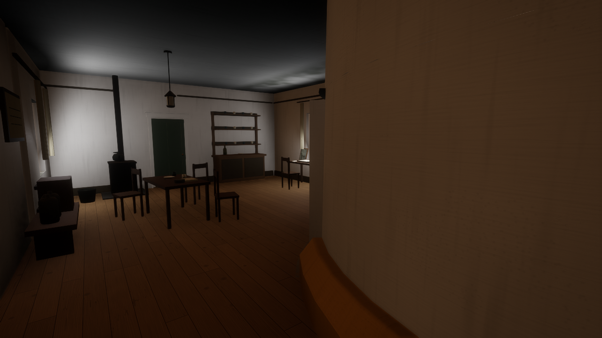
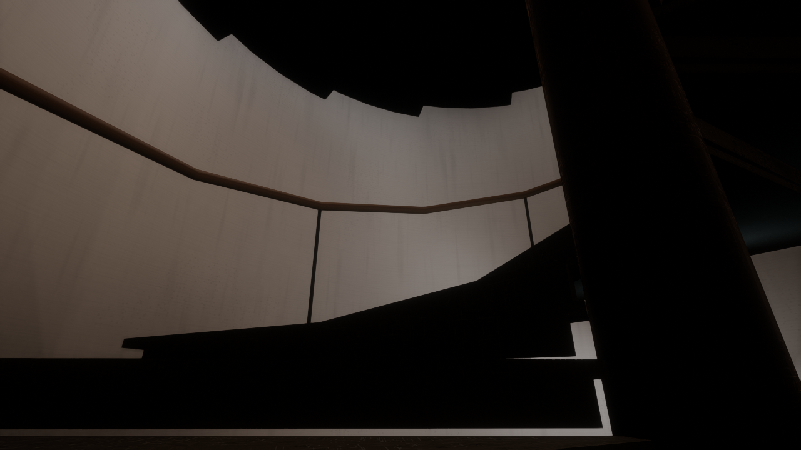
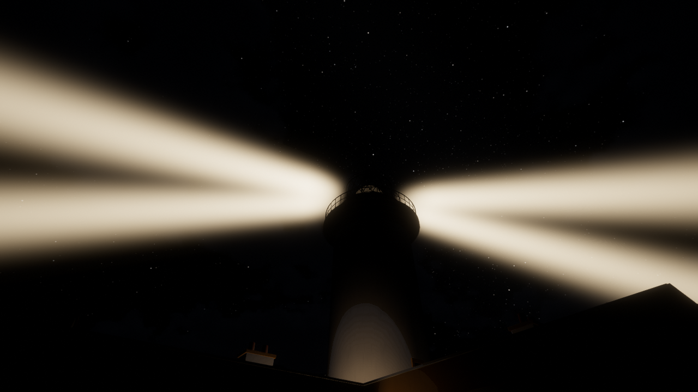

# Seven Hunters

### Three keepers vanished. Tonight, the light is yours.

A first-person narrative exploration game set on a remote Scottish lighthouse island in January 1901. Explore Eilean Mòr, learn the keeper's routine, and keep the light burning.

**[▶ Play in your browser](https://thehillbeyondthisone.github.io/seven-hunters/)** · [Report a problem](https://github.com/thehillbeyondthisone/seven-hunters/issues) · [Historical sources](#history-and-fiction)

[](https://github.com/thehillbeyondthisone/seven-hunters/actions/workflows/deploy.yml)



*Eilean Mòr, the Flannan Isles. A winter afternoon is already giving way to night.*

| | |
|---|---|
| **What it is** | Atmospheric exploration, lighthouse duties, and a story to discover at your own pace |
| **Current release** | A playable work in progress |
| **How to play** | Desktop keyboard and mouse, or phone/tablet touch controls; no download or account required |
| **Mood** | Quiet, eerie, and grounded in the sea and weather |

## Your posting

You are a newly posted lighthouse keeper on Eilean Mòr, a small rocky island off Scotland's Outer Hebrides. Your job is to tend the station and keep its light working. Follow the instructions you find, explore, and let the story unfold as you play.

**Seven Hunters** is a traditional name for the Flannan Isles themselves. The title belongs to the landscape that surrounds you.

## What you do

- **Explore the island.** Walk through the station, tower, and coastal paths.
- **Tend the lighthouse.** Learn its machinery and carry out the keeper's duties.
- **Observe your surroundings.** Take in the changing light, sea, and weather.
- **Read at your own pace.** Discover the story through play and the records you find.
- **Bring something home.** Use Mary’s six-frame Brownie, keep the later watches through the storm, and hand over the station when relief arrives. The prints are developed ashore.

The local working version follows the completed scene review, with explicit review boundaries before unresolved dialogue and the held ending. For a local chapter review, open [remaining-watches.html](public/remaining-watches.html) with the dev server running. Each review uses a separate save; cut and held source chapters are labelled as legacy reviews. The live browser link above updates on publication.

The first night teaches the lamp, winding and contact with Cate before the
morning journal. Weather begins on day two: instruments first, then a daylight
balcony lesson with generous standing and viewing areas. The
[weather study](public/weather-observations.html) opens a separate review save.

The game takes inspiration from *Firewatch* in its atmosphere, exploration, and focus on the experience of a solitary job.

## Local story review — 1 November 2026

The local working tree now follows the completed scene review: a practical boat handover, paper sheets without scrolling, guided first-contact shutter work, rope-secured gates, a foggy tramway return, a guaranteed smoke observation, a supported chair photograph and the scope-assisted storm impact. The first-night and later islet-light arc is cut, along with the moving service-lantern beat.

The original confession and ending remain available as labelled legacy reviews. Normal revised play stops at the unresolved reconnection and post-storm story boundaries; it does not invent the missing middle or proceed to the held ending. The user-supplied stings, morning music and paper-writing recordings are still pending. See [implementation and verification](docs/REVIEW-IMPLEMENTATION.md).

## A look around

| The crossing | The keepers' room |
|---|---|
|  |  |
| Read the papers in your coat while the boat approaches. | Find your instructions and the tools for the watch. |

| The tower stairs | The night watch |
|---|---|
|  |  |
| Climb through the tower to the lamp and its clockwork. | The beam is your presence across the sea. |

*These are captures of the game scene at scripted viewpoints, rendered by the game's own WebGPU renderer. They are not concept paintings. Performance and appearance vary with browser and hardware.*

## Getting started

1. Open **[Play Seven Hunters](https://thehillbeyondthisone.github.io/seven-hunters/)** in a browser with WebGPU enabled. Phones and tablets automatically show touch controls; landscape gives you the clearest view.
2. Let the first load finish. Shader preparation can take a minute or more on some machines. Fresh arrivals prepare the opening scene first, then warm the remaining station shaders during the boat crossing. Continuing an onshore watch prepares the whole scene before play.
3. Tap or click to begin, then hear the practical handover. **Next remark** on touch or **Enter** on desktop advances one remark. **Read papers** or **B** opens your packet and pauses the approach. After the handover, **Go to landing** / **Enter** finishes the approach; **Step ashore** / **Enter** leaves the boat.
4. Follow the in-game instructions. Small objective markers help you find the next task; arrows point toward it when it is off screen.
5. Look at an object and tap its named action button on mobile, or use **E** on desktop. Hold the action button (or **E**) for tasks that ask you to keep it pressed.

You can disable objective markers in **H → Camera → Keeping the watch**. The night saves automatically in this browser; returning offers to continue or begin again. Reading pages pauses the story clock, and some prompts let you wait until the next event.

After the 6 January smoke chapter, continue into the daylight photography watch. The returning-islet-light investigation is cut from the revised path; its original source remains available as a legacy review.

The sea is dangerous in normal desktop and touch story play. At designated
intact landing rails, hold the interaction action to brace. If swept into the
water, reach nearby rungs or shallow footing quickly; hold the named climbing
action to recover. The storm lantern goes out on immersion. Death offers
**Retry from safety**, restoring the last safe watch checkpoint.

To travel between lighthouse levels, look at the bottom of the spiral stair or the open end of the lantern hatch and use **E** (or the named touch action). One press walks the stairs automatically. Walking into the lower entrance also starts the climb; descending always requires a fresh press, so approaching the winding crank cannot take you downstairs. Each journey takes 5.6 seconds, following the first and last treads with gentle camera motion and footsteps. A fade covers the long middle climb. You never need to steer along the spiral or hatch steps. Approach the telescope on its sill to take it; its prompt stays out of the stair arrival. The driving-weight lesson is viewed down through the hatch from the lantern floor.

After unpacking, examine the Brownie and take it from the desk. **C** raises or puts away the camera; hold **E** to expose a daylight view, release it, then hold **E** again to wind the film. On touch devices use **Tools → Brownie** and the named action. Its one six-frame roll stays with you through the watch and is developed ashore.

To replay a cutscene without reloading the island, open the **backtick (`) debug menu → Replay cutscenes**. First look back, First lighting, and The driving weight can be replayed while ashore. **Continue / Esc** returns to your current watch with its position, time, apparatus and progress restored.

The added stair gates have been removed; the existing hatch handrails remain. This travel flow applies to the normal desktop/touch story; the separate experimental VR exploration preview retains its location controls.

**Camera bob** is optional: Settings (H) → Camera → View, or Camera bob in the touch pause menu. The choice is saved on this device and controls walking bob and tower head motion. Reduced-motion devices start with it off; the stair journey retains its smooth movement without head bob.

Holding the balcony rail is a continuous lookout and does not jump the clock to the next duty. Use the chair or stool when you deliberately want to wait. During Morse dialogue, **Space** or the mobile **Finish message** button reveals the full current message or finishes sending your chosen reply. Each reply still needs to be chosen, and the next message starts from the beginning.

Outside at night, put out the storm lantern with **L** (or Tools · Lantern) and let your eyes adjust for about five seconds: the landscape and faint stars gradually become clearer. Relighting the lantern quickly removes the effect. After the two-hour rest, you wake with your storm lantern lit and in hand.

### Touch controls

- **Drag on the left** to walk; **drag on the right** to look. Use both thumbs together.
- **Next remark → Read papers → Go to landing → Step ashore** gets you through the handover and onto the island. The boat also approaches naturally while you listen.
- **Tools** opens your Lantern, Telescope, Papers, Hurry and Jump. Equipment becomes available when collected.
- **Pause** stops the watch and opens sound and graphics settings. The settings panel includes **Touch controls** help.
- Touch buttons use large period lettering, prevent accidental text selection, and work while another finger is walking or looking.

See [mobile controls and local phone setup](docs/MOBILE.md). For a forced touch view, use [the mobile link](https://thehillbeyondthisone.github.io/seven-hunters/?mobile).

### Keyboard and mouse

| Input | Action |
|---|---|
| **W A S D** | Walk |
| **Shift** | Hurry |
| **Mouse** | Look; click the scene to capture the mouse |
| **Esc** | Release the mouse; dismiss supported reading panels |
| **E** | Interact with the object you are looking at |
| **Hold E** | Perform tasks that ask you to keep the action pressed |
| **Enter** | On the boat: next handover remark, then advance the approach and step ashore |
| **B** | Reopen the papers in your coat |
| **C** | Raise or put away your Brownie after taking it |
| **Right mouse button** | Look through the telescope after collecting it |
| **L** | Toggle your storm lantern after taking it from the keepers' room |
| **Space** | Complete the current Morse message |
| **H** | Open settings |
| **M** | Mute sound |
| **P** | Photo mode |
| **F1** or **?** | Show all controls |
| **Backtick (`)** | Open the desktop development menu |

### Requirements and troubleshooting

The game has **mobile touch controls**: a floating left
thumbstick, right-side drag to look, contextual actions and a Tools drawer.
Double-click `start-mobile.bat` for an HTTPS link to open on a phone on the same
Wi-Fi. See [mobile controls and setup](docs/MOBILE.md). Phone performance and
physical touch/audio still need device testing; browser checks verify the interface and game flow.

- **WebGPU support is required.** Browser version, operating system, GPU, and driver all affect availability. Hardware acceleration should be enabled. WebGPU-enabled Safari may also work; support is not certified across all browser/device combinations.
- **Desktop uses keyboard and mouse.** Phones and tablets select touch controls automatically. Sustained mobile performance is not established.
- **A capable GPU helps.** Dynamic resolution can reduce rendering resolution on slower machines. Use **H** to adjust graphics settings if play is sluggish.
- **If loading fails,** check the displayed error, update the browser and graphics driver, and try Chrome or Edge with hardware acceleration enabled. If reporting a bug, include the browser, GPU, error text, and where it occurred.
- **Saves are local to your browser.** Clearing site storage can erase them; private browsing and another computer may not retain the same progress.

## History and fiction

The game draws on the real Flannan Isles lighthouse and the disappearance of three keepers in December 1900. Historical sources provide context for the setting.

The game uses the real island and terrain data, the lighthouse station, and period sources as its foundation. It does not claim to be a measured reconstruction of every room, furnishing, or piece of equipment.

The playable characters, dialogue, and narrative are original fiction. The boat, interiors, and several visual details are provisional reconstructions. The game distinguishes documented history from fictional storytelling.

Start with these sources:

- [Northern Lighthouse Board: Flannan Islands](https://www.nlb.org.uk/lighthouses/flannan-islands/) — the station and the islands' “Seven Hunters” name.
- [Northern Lighthouse Board: the disappearance and contemporary reports](https://www.nlb.org.uk/history/flannan-isles/) — the surviving accounts and investigation.
- [National Records of Scotland: the lighthouse keepers' disappearance](https://blog.nrscotland.gov.uk/2023/12/12/flannan-isles-lighthouse-keepers-the-disappearance/) — archival context and records.

## What is included today

The current release includes island and station exploration, lighthouse duties, save/resume, optional objective guidance, and desktop photo mode. Development is ongoing.

There are also separate exploration and development routes:

| Link | What it opens |
|---|---|
| [Explore the island](https://thehillbeyondthisone.github.io/seven-hunters/?nostory) | Walk around without the story schedule |
| [Sea and weather preview](https://thehillbeyondthisone.github.io/seven-hunters/?weatherPreview) | An experimental cycle from settled conditions to an Atlantic gale |
| [Boat arrival preview](https://thehillbeyondthisone.github.io/seven-hunters/?arrivalPreview) | Try the opening with a separate preview save |
| [Coast and isolation reviews](https://thehillbeyondthisone.github.io/seven-hunters/coast-and-isolation.html) | Returning light, dangerous landing, and isolated storm preparation/lookout/return scenes, each with a separate save |
| [Tidewater](https://thehillbeyondthisone.github.io/seven-hunters/?setting=tidewater) | The original island fishing game retained in the codebase |

An experimental WebXR exploration preview is documented in [VR-PREVIEW.md](docs/VR-PREVIEW.md). It has not been certified for physical headset performance, controls, or comfort. Exploration and development previews use separate saves or no watch save.

## Run it locally

For the latest local environment review, see [Weather, work, and the island](docs/LANDSCAPE-PASS.md).
The live study is at `/landscape-preview.html` while the development server is running.

Install **Node.js 22 or newer**, then:

```sh
git clone https://github.com/thehillbeyondthisone/seven-hunters.git
cd seven-hunters
npm ci
npm run dev
```

Open **http://127.0.0.1:5189/**. On Windows, after installing dependencies, `start.bat` starts the local game; it clears any listener on port 5189 first.

```sh
npm run build          # Create the static site in dist/
npm run preview        # Serve that production build locally
npm test               # Logic, route, story, guidance, and native WebGPU engine checks
npm run test:weather   # Weather logic checks
npm run test:xr-scene  # Native WebGPU stereo scene checks
npm run test:pipelines # Shared pipeline correctness, including rendered material colors
npm run test:loading   # Staged warmup, early landing, binary meshes and pipeline sharing
npm run test:startup   # Local startup stages and compilation counts (native WebGPU)
```

The final part of `npm test` requires a working native WebGPU adapter. Story and route checks can also run independently with `node test/demo-story.mjs` and `node test/demo-walk.mjs`. Automated checks do not establish performance, audio quality, or physical headset behavior.

The startup check measures scene construction, shader preparation and warmup using local assets.
It excludes browser downloads and reports hardware-dependent times; use the same machine and
query for comparisons (`STARTUP_QUERY` overrides the default `?bench&noAudio`). The renderer shares
compiled mesh pipelines when generated WGSL, render state and binding layouts match, while keeping
each material's uniform buffers and textures independent. Flannan also omits the hidden Tidewater
fishing boat from its render scene, avoiding compilation of its unused materials.

Fresh boat arrivals compile room surfaces and lantern details one at a time after the loading screen
closes. The landing fade waits for readiness if you skip the crossing early. Saved onshore watches,
interior previews, VR and benchmark captures retain the full warmup. Use `?warmup=full` to compare;
`STARTUP_QUERY='?bench&noAudio&warmup=staged'` exercises staged startup in the native check and reports
both opening readiness and whole-scene readiness.

Vite serves the large authored station and lantern mesh exports as hashed binary assets. The build
plugin retains the original generated JavaScript for Blender authoring and Node tools, while the
browser decodes aligned float32/uint32 arrays directly from the asset buffer. Production URLs remain
relative for GitHub Pages; development uses the local `/__packed-models/` endpoint.

Pushes to `main` build and deploy `dist/` through [GitHub Actions](.github/workflows/deploy.yml). The site uses relative asset paths so it can run under the `/seven-hunters/` Pages URL.

## Built on Tidewater

Seven Hunters grew out of **[Tidewater by Daniel Greenheck / DRG Software Solutions](https://github.com/dgreenheck/tidewater)**, a browser fishing game with a custom WebGPU engine. Its ocean, atmosphere, rendering foundation, and original fishing mode remain part of this project. [Play the upstream game](https://dgreenheck.github.io/tidewater/).

The renderer uses JavaScript and WGSL, with an FFT ocean, volumetric clouds, atmospheric haze, dynamic lighting, and temporal post-processing. Vite builds the static browser release. Story code lives in `src/story/`, lighthouse machinery in `src/station/`, and the Flannan environment in `src/world/flannan/`.

### AI assistance and provenance

Development uses AI assistance for implementation, writing, research, and visual iteration. This repository's publication and README were prepared with OpenAI Codex. Generated code and historical claims still need review against tests, rendered results, and cited sources; AI output is not archival evidence.

The screenshots above come from the running scene renderer. Third-party models, sounds, terrain data, textures, and their licenses are listed in [CREDITS.md](CREDITS.md). The historical interpretation, hardware compatibility, and longer narrative remain works in progress.

## License and credits

Code is released under the **[MIT license](LICENSE)**, retaining the upstream copyright notice. Third-party assets keep their own licenses. See [CREDITS.md](CREDITS.md) and the credits beside the assets for attribution and terms.
